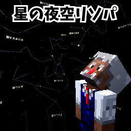

# StarNightSky BE

マインクラフト統合版の夜空に、本物の星空を映すリソースパックです。
星座線や星座名の入った夜空が、時間とともにゆっくり回ります。

A resource pack for Minecraft Bedrock Edition that shows a real star sky at night. [English read me](README_en.txt)

これはマインクラフトの公式の製品ではありません。Mojang や Microsoft が認めたものでも、関わっているものでもありません。
NOT AN OFFICIAL MINECRAFT PRODUCT. NOT APPROVED BY OR ASSOCIATED WITH MOJANG OR MICROSOFT.

Java版は [StarNightSky JE](https://github.com/lonely-minecraft/StarNightSky-JE) にあります。

## ダウンロード

**[StarNightSky_BE.mcpack をダウンロード(最新版)](https://github.com/lonely-minecraft/StarNightSky-BE/releases/latest/download/StarNightSky_BE.mcpack)**

これまでの版は、[Releases](https://github.com/lonely-minecraft/StarNightSky-BE/releases) にあります。

## できること

- 夜空の種類を5つから選べます: 星だけ / 星＋星座線 / 星＋星座線＋星座名 / 星座絵入り / 天の川の見える本物の星空(NASA)
- 星空が、太陽や月と同じ向きに、1日で1回転します。
- 星空が毎日少しずつずれ、8日で1年分の星空がめぐります。
- 雨の夜は、星空が隠れます。
- 星座線の形を、標準(IAUの星図の形)と H.A.レイ方式から選べます。
- パックの設定画面と説明は、日本語と英語に対応しています。

## 動作を確認した環境

- Windows 版 v26.52 で動作を確認しました。
- ほかの機種(スマホ、Switch、ゲーム機など)やバージョンでは確認していません。
- マルチプレイでの動作は確認していません。

## 入れ方(Windows)

1. マインクラフトを終了します。(開いたままだと、取り込まれないことがあります。)
2. `StarNightSky_BE.mcpack` をダブルクリックします。マインクラフトが起動して、「インポート完了」と表示されます。
3. ワールドの設定を開き、「リソースパック」で StarNightSky BE を有効にします。
4. ワールドに入り、夜になるのを待ちます。F5 キーで三人称の視点にすると、星空が見えます。

くわしい使い方、パックの設定、困ったときの対処は、[説明書(日本語)](README_ja.txt) を見てください。

## 知っておいてほしいこと

- **星空は、三人称の視点で見るものです。** 一人称の視点では、星空が視点と一緒に動いてしまうので、最初は隠してあります。
- **パックの設定の「描画距離」を、ビデオ設定の描画距離と同じ値にしてください。** 合っていないと、星が山の手前に描かれたり、星空が欠けたりします。
- マインクラフトの太陽に合わせて、「赤道で見た星空」にしています。日本で見る星空とは、傾きが違います。
- マインクラフトにもともとある星(架空の星)は、そのまま見えます。
- このパックは、プレイヤーの見た目の定義を書き換えています。マインクラフトの更新後に、プレイヤーの表示や動きがおかしくなったら、このパックを外してください。
- **パックを外すときは、外したあと、ワールドに入らずにマインクラフトを終了してください。** 再起動する前にワールドに入ると、パックが有効に戻ることがあります。

## クレジットとライセンス

このパックは、次の素材を使っています。くわしくは [CREDITS.txt](CREDITS.txt) を見てください。

| 素材 | 出典 | ライセンス |
|---|---|---|
| 星のデータ | Yale Bright Star Catalogue, 5th Revised Ed.(Hoffleit & Warren 1991)、CDS | — |
| 星座線(標準)と星座名 | [d3-celestial](https://github.com/ofrohn/d3-celestial)、Copyright (c) 2015 Olaf Frohn | [BSD 3-Clause](LICENSE_d3-celestial.txt) |
| 星座名の文字 | Noto Sans JP | SIL Open Font License 1.1 |
| 星座線(H.A.レイ方式) | [Stellarium の modern_rey](https://github.com/Stellarium/stellarium/tree/master/skycultures/modern_rey)(Stellarium's team、H.A.レイ『The Stars: A New Way to See Them』1952年にもとづく) | [CC BY-SA 4.0](https://creativecommons.org/licenses/by-sa/4.0/deed.ja) |
| 線の星の位置(H.A.レイ方式) | Hipparcos Catalogue(ESA 1997)、VizieR I/239 | — |
| 星座絵 | シドニー・ホール『ウラニアの鏡』(Urania's Mirror、1824年)。[Wikimedia Commons](https://commons.wikimedia.org/wiki/Category:Urania%27s_Mirror) のスキャン画像 | パブリックドメイン |
| 天の川の星空 | [NASA/Goddard Space Flight Center Scientific Visualization Studio](https://svs.gsfc.nasa.gov/4851)、Gaia DR2: ESA/Gaia/DPAC | — |

H.A.レイ方式の星座線を含む画像(`textures/night_sky/lines_rey.png` と `names_rey.png`)は、CC BY-SA 4.0 で配布します。

## 作者

damun-craft.com
<https://damun-craft.com/>
